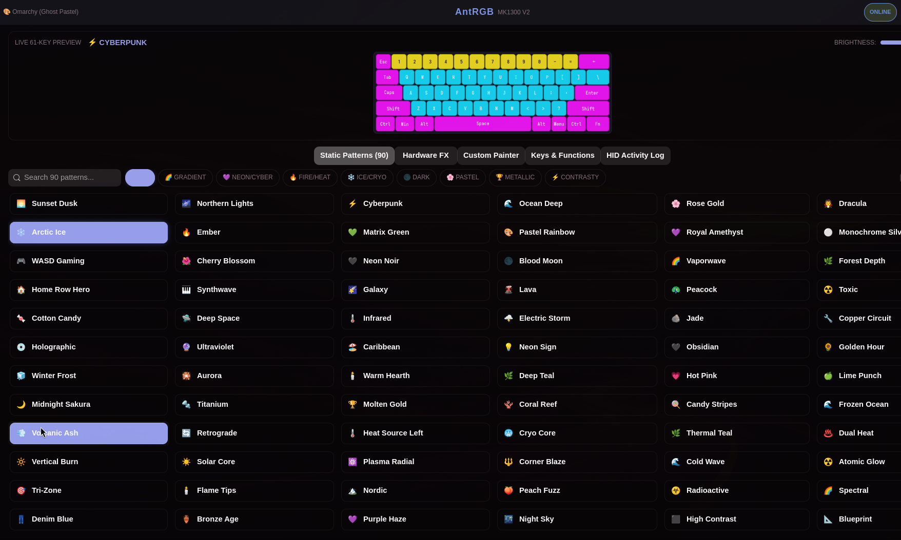
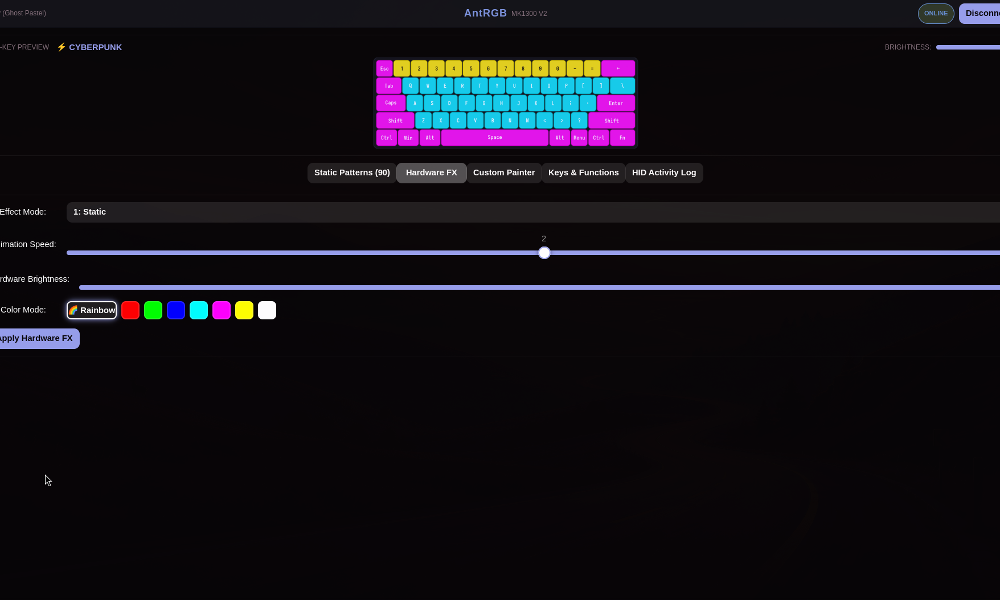
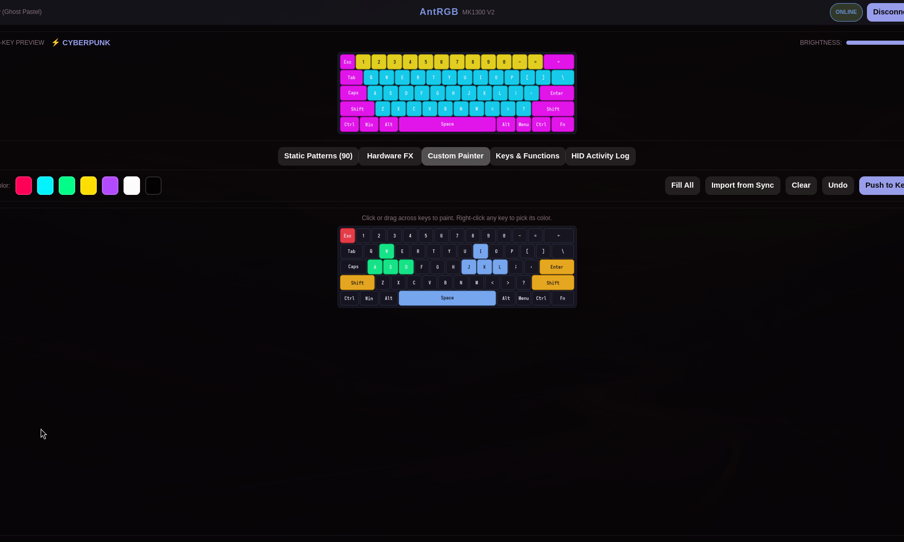
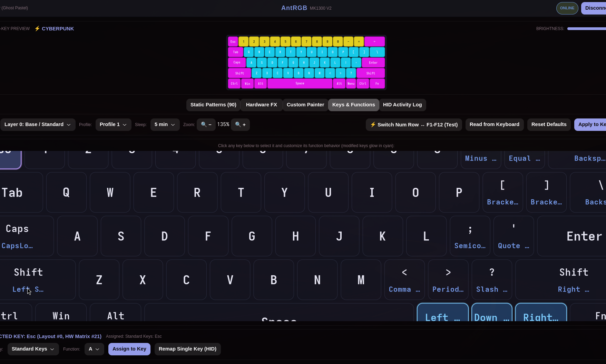

# AntRGB (mk1300-linux / mk1300-win)

[](https://github.com/10supernova/mk1300-linux/releases)
[](LICENSE)
[](https://github.com/10supernova/mk1300-linux/releases)

A sleek, native desktop application and CLI for controlling per-key RGB lighting on the **Ant Esports MK1300 V2** 60% mechanical keyboard. Designed with full native support for **Omarchy / Arch Linux / Hyprland / Wayland** and **Windows**.

Features a modern **Tokyo Night** dark theme with **automatic Omarchy theme integration**, an interactive 61-key visualizer canvas, 140 static patterns ported 1:1 from upstream, hardware lighting animation controls, and custom preset painting.

---

## 📦 Downloads & Releases

Pre-built binaries and packages are available on the [GitHub Releases Page](https://github.com/10supernova/mk1300-linux/releases/latest):

| Platform | Download Asset | Type | Description |
|---|---|---|---|
| **Windows** | [`mk1300-win-setup-1.0.0.exe`](https://github.com/10supernova/mk1300-linux/releases/latest) | Installer | Inno Setup installer; adds CLI to `PATH` & Start Menu |
| **Windows** | [`mk1300-win.exe`](https://github.com/10supernova/mk1300-linux/releases/latest) | Standalone | Portable single-file Windows CLI executable |
| **Arch Linux** | [`mk1300-linux-1.0.0-1-any.pkg.tar.zst`](https://github.com/10supernova/mk1300-linux/releases/latest) | Arch Package | Install directly with `sudo pacman -U <file>` |
| **Linux (All)** | [`mk1300-linux-1.0.0.tar.gz`](https://github.com/10supernova/mk1300-linux/releases/latest) | Source Tarball | Source package with PKGBUILD, scripts, and udev rules |

---

## 📸 Screenshots & Feature Gallery

### 1. 140 Static Patterns & Live 61-Key Visualizer
Browse 140 static patterns (90 classic + 50 contrasty) grouped by category (*Gradient, Neon/Cyber, Fire/Heat, Ice/Cryo, Dark, Pastel, Metallic, Contrasty*). Real-time 61-key canvas visualizer renders lighting accurately with key legends.



---

### 2. Built-in Hardware Lighting FX
Control the MK1300 V2 keyboard's onboard hardware animations (16 modes: *Breath, Spin, Stream, Bloom, Rain, Meteor, Soduko, etc.*) with speed, brightness, and RGB/Rainbow spectrum controls.



---

### 3. Custom Per-Key Canvas Painter
Click or drag across the interactive 61-key canvas to paint any key color with color picker, palette, batch fill, undo, and one-click import from active pattern.



---

### 4. Key Remapping & Function Layer Switcher
Remap keys, assign function shortcuts, and switch between Base Layer 0 and Fn Layer 1 with instant hardware write. Includes one-click test toggle for Number Row ↔ F1–F12.



---

## Upstream Credit & License Compliance

This project is a derivative work ported from the open-source web controller:
- **Upstream Project:** [kickTROLL/mk1300v2_RGB](https://github.com/kickTROLL/mk1300v2_RGB)
- **Original Author:** Yash ([@kickTROLL](https://github.com/kickTROLL))
- **License:** Apache License, Version 2.0 (see [LICENSE](LICENSE) and [NOTICE](NOTICE))

AntRGB replaces WebHID and browser requirements with a native Python + `hidapi` driver and a native GTK4 / libadwaita UI, while strictly reproducing all upstream RGB protocols and pattern mathematical formulas 1:1.

---

## 🚀 Installation & Setup

### 🐧 Arch Linux / Omarchy

#### Method 1: Install Pre-built Arch Package (Recommended)
```bash
# Download latest package from Releases and install via pacman:
sudo pacman -U mk1300-linux-1.0.0-1-any.pkg.tar.zst
```

#### Method 2: Build from Source with PKGBUILD
```bash
git clone https://github.com/10supernova/mk1300-linux.git
cd mk1300-linux
makepkg -si
```

#### Method 3: Run Directly from Source
```bash
# Dependencies
sudo pacman -S python python-gobject gtk4 libadwaita python-hidapi

# Launch GUI
./mk1300-gui

# Launch CLI
./mk1300-cli info
```

#### Linux udev Permissions
To allow non-root users to communicate with the keyboard over `/dev/hidraw*`:
```bash
sudo cp udev/99-mk1300.rules /etc/udev/rules.d/
sudo udevadm control --reload-rules
sudo udevadm trigger
```

---

### 🪟 Windows Setup

#### Method 1: Inno Setup Installer (`.exe`)
1. Download `mk1300-win-setup-1.0.0.exe` from [Releases](https://github.com/10supernova/mk1300-linux/releases/latest).
2. Run the installer. It installs `mk1300-win.exe` to `%LocalAppData%\Programs\MK1300RGB` and adds it to your user `PATH`.
3. Open PowerShell or Command Prompt and run:
   ```powershell
   mk1300-win info
   mk1300-win apply-pattern sunset
   ```

#### Method 2: Standalone Portable Binary
1. Download `mk1300-win.exe`.
2. Run it directly from Terminal/PowerShell:
   ```cmd
   mk1300-win.exe list-patterns
   mk1300-win.exe hw-animation --mode 2 --brightness 4 --speed 2 --color multi
   ```

#### Building on Windows Locally
If you prefer building from source on Windows:
```cmd
git clone https://github.com/10supernova/mk1300-linux.git
cd mk1300-linux
windows\build-windows.bat
```

---

## ✨ Features

1. **Protocol 1:1 Fidelity:**
   - 64-byte command reports with `command-6` framing wrapper.
   - 56-byte chunked bulk matrix writes.
   - Single-key color addressing.
   - Hardware animation configuration flow (Global Config Type 0 + Mode Template Type 1).
   - Upstream byte offsets, chunk sizes, response slices, and timeouts matched 1:1.

2. **140 Static RGB Patterns:**
   - All 90 static patterns from `effects.js` ported with identical HSL conversions and rounding math.
   - All 50 contrasty patterns from `extra-effects.js`.
   - Categorized by theme: *Gradient, Neon/Cyber, Fire/Heat, Ice/Cryo, Dark, Pastel, Metallic, and Contrasty*.

3. **Hardware Animation Control:**
   - 16 hardware animation modes: *Static, Breath, Swing, Spin, Stream, Bloom, UDWawe, Cross, Rain, Meteor, TrigSpread, TrigSingle, Soduko, Tide, and UserLight*.
   - Speed (0–4), Brightness (0–4), Direction (0/1), and Rainbow/Multi or Custom HSV solid color.
   - Revision toggle: Mode 16 (Standard) vs Mode 20 (Rev 2.0).

4. **Accurate 61-Key Matrix Layout:**
   - Matrix index 21 quirk for the `Esc` key preserved from reference hardware behavior.
   - Exact physical proportions and key legends rendered with soft glows in the GTK4 canvas.

5. **Tokyo Night & Omarchy UI:**
   - Tokyo Night palette (`#1a1b26`, `#16161e`, `#292e42`, `#c0caf5`, `#7aa2f7`).
   - Dynamically reads active system accent colors from `~/.config/omarchy/` (`omasettings.json` and `colors.toml`) on Linux.
   - Interactive 61-key canvas with per-key custom color picker, fill, clear, and undo.

6. **Bricking Protection:**
   - Command byte `85` (`0x55`, firmware/bootloader/flash) and sub-command `[15, 255]` (factory reset) are hardcoded blocked.
   - Only validated RGB configuration commands can reach the keyboard controller.

---

## ⌨️ CLI Reference

On Linux, invoke via `mk1300-cli`. On Windows, invoke via `mk1300-win`.

| Command | Arguments | Description |
|---|---|---|
| `info` | none | Query connected keyboard PID, firmware, profile, and lighting mode |
| `list-patterns` | `[--category <cat>] [--search <str>]` | List all 140 static patterns |
| `apply-pattern` | `<id> [--brightness 10-100] [--mode 16\|20]` | Apply static pattern to keyboard |
| `set-key` | `<key_name\|index> <#hex>` | Set individual key RGB color (e.g. `Esc "#ff0000"`) |
| `set-all` | `<#hex> [--brightness 10-100]` | Set solid RGB color across all 61 keys |
| `hw-animation` | `--mode <0-16/20> [--brightness 0-4] [--speed 0-4] [--color multi\|#hex]` | Configure built-in hardware animation |
| `get-keymap` | `[--layer 0\|1]` | Read and display live key mappings from keyboard |
| `remap-key` | `<key> <action> [--layer 0\|1]` | Remap a key function on the keyboard |
| `switch-num-layer`| `[--layer 0\|1] [--revert]` | Toggle number row between numbers and F1–F12 |
| `restore-last` | none | Re-apply last applied pattern and brightness |
| `smoke-test` | none | Run hardware verification test (Esc red, Q green, W blue) |

### CLI Usage Examples:
```bash
# Check device detection
mk1300-cli info

# Apply Sunset pattern at full brightness
mk1300-cli apply-pattern sunset --brightness 100

# Set Esc key to vibrant red
mk1300-cli set-key Esc "#ff0000"

# Set all keys to warm white
mk1300-cli set-all "#ffeedd" --brightness 80

# Trigger hardware rainbow breathing animation
mk1300-cli hw-animation --mode 2 --brightness 4 --speed 2 --color multi
```

---

## 🖥️ Hyprland & Desktop Autostart

To restore your lighting pattern automatically upon logging into Hyprland or Wayland:

### Option A: Hyprland `exec-once`
Add to `~/.config/hypr/hyprland.conf`:
```ini
exec-once = mk1300-cli restore-last
```

### Option B: systemd User Service
```bash
mkdir -p ~/.config/systemd/user/
cp systemd/mk1300-restore.service ~/.config/systemd/user/
systemctl --user daemon-reload
systemctl --user enable --now mk1300-restore.service
```

---

## 🧪 Verification & Smoke Test

All static patterns and HID protocol packets are tested 1:1 against the original Node.js reference driver:

```bash
# Run unit & protocol tests
./run_tests.py
```

### Hardware Verification:
Once plugged in, run:
```bash
./smoke_test.py
```
This tests:
1. Interface enumeration and config reading
2. `testSingleKey`: Esc = Red, Q = Green, W = Blue
3. Static pattern application: Sunset Dusk
4. Hardware animation: Rainbow Breath mode

---

## 📄 License

Licensed under the Apache License, Version 2.0. See [LICENSE](LICENSE) and [NOTICE](NOTICE) for details.
Upstream original code copyright Yash ([@kickTROLL](https://github.com/kickTROLL)).
